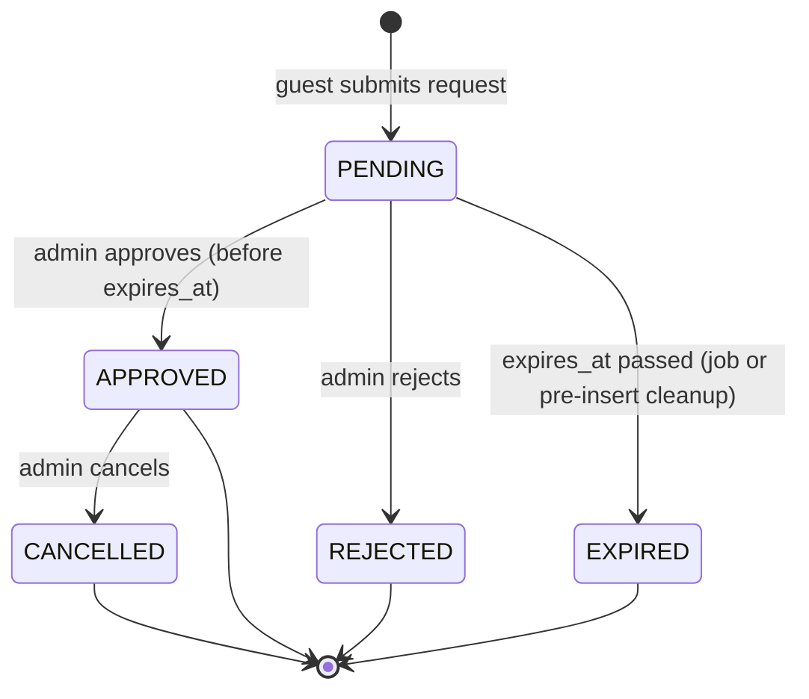

# Data model

> Implemented in [`apps/api/prisma/`](../apps/api/prisma/): `schema.prisma`, the migrations, and [`checks/booking-guards.sql`](../apps/api/prisma/checks/booking-guards.sql), which exercises the constraints with plain SQL. Tables marked with a later week are not implemented yet.

## Booking lifecycle

A guest sends a booking request. The request **holds the dates** while it waits for a decision. If the hotel does not decide before `expires_at`, the hold is released.



**Active** statuses are `PENDING` and `APPROVED`. Only active bookings occupy a room.

## Tables

### `rooms`

| Column                     | Type            | Notes                                                        |
| -------------------------- | --------------- | ------------------------------------------------------------ |
| `id`                       | `uuid` PK       |                                                              |
| `slug`                     | `text` unique   | URL-friendly name                                            |
| `name`, `description`      | `text`          |                                                              |
| `capacity`                 | `int`           | `CHECK (capacity > 0)`                                       |
| `base_price`               | `numeric(10,2)` | `CHECK (base_price >= 0)`, serialized as a string in the API |
| `currency`                 | `text`          | default `EUR`                                                |
| `is_active`                | `boolean`       | inactive rooms are not bookable                              |
| `created_at`, `updated_at` | `timestamptz`   |                                                              |

### `room_blocks`

Dates the hotel closes manually (maintenance, private use).

| Column                   | Type                | Notes                                                               |
| ------------------------ | ------------------- | ------------------------------------------------------------------- |
| `id`                     | `uuid` PK           |                                                                     |
| `room_id`                | `uuid` FK → `rooms` |                                                                     |
| `start_date`, `end_date` | `date`              | half-open `[start_date, end_date)`, `CHECK (end_date > start_date)` |
| `reason`                 | `text` null         |                                                                     |

### `bookings`

| Column                                             | Type                                     | Notes                                                                                               |
| -------------------------------------------------- | ---------------------------------------- | --------------------------------------------------------------------------------------------------- |
| `id`                                               | `uuid` PK                                |                                                                                                     |
| `room_id`                                          | `uuid` FK → `rooms`                      |                                                                                                     |
| `check_in`, `check_out`                            | `date`                                   | half-open `[check_in, check_out)`, `CHECK (check_out > check_in)`                                   |
| `guests`                                           | `int`                                    | `CHECK (guests > 0)`; `guests <= capacity` is checked in the service                                |
| `guest_name`, `guest_email`, `guest_phone`, `note` | `text`                                   | phone and note are nullable                                                                         |
| `status`                                           | `booking_status`                         | `PENDING`, `APPROVED`, `REJECTED`, `EXPIRED`, `CANCELLED`                                           |
| `expires_at`                                       | `timestamptz`                            | set by the database: `now() + PENDING_TTL`; `CHECK (status <> 'PENDING' OR expires_at IS NOT NULL)` |
| `decided_at`, `decided_by_id`                      | `timestamptz`, `uuid` FK → `admin_users` | null until approved or rejected                                                                     |
| `created_at`, `updated_at`                         | `timestamptz`                            |                                                                                                     |

### `admin_users`

| Column          | Type          | Notes    |
| --------------- | ------------- | -------- |
| `id`            | `uuid` PK     |          |
| `email`         | `text` unique |          |
| `password_hash` | `text`        | argon2id |
| `name`          | `text`        |          |

### `idempotency_keys` (week 2)

| Column                             | Type           | Notes                                               |
| ---------------------------------- | -------------- | --------------------------------------------------- |
| `key`                              | `text` PK      | value of the `Idempotency-Key` header               |
| `request_hash`                     | `text`         | hash of method + path + body                        |
| `state`                            | `text`         | `IN_PROGRESS` or `COMPLETED`                        |
| `response_status`, `response_body` | `int`, `jsonb` | stored response, replayed for the same key and body |
| `created_at`, `expires_at`         | `timestamptz`  | cleaned up after a TTL                              |

### `notification_outbox` (later)

Rows written in the same transaction as the booking change. A worker sends them through the notification provider with a timeout and retries with backoff.

## The double-booking guard

Prisma's schema language cannot express this, so it lives in a raw SQL migration:

```sql
CREATE EXTENSION IF NOT EXISTS btree_gist;

ALTER TABLE bookings
  ADD CONSTRAINT bookings_no_overlap_active
  EXCLUDE USING gist (
    room_id WITH =,
    daterange(check_in, check_out, '[)') WITH &&
  )
  WHERE (status IN ('PENDING', 'APPROVED'));
```

Violations fail with SQLSTATE `23P01`, which the API maps to `409 ROOM_NOT_AVAILABLE`.

## Expiry rules

The constraint does not know about time. A `PENDING` row whose `expires_at` has passed still blocks the dates until its status changes. That is why expiry happens in two places:

1. **Before inserting a booking**, in the same transaction:
   ```sql
   UPDATE bookings SET status = 'EXPIRED'
   WHERE room_id = $1 AND status = 'PENDING' AND expires_at <= now();
   ```
2. **A periodic job** expires the rest, so the admin list and availability stay accurate.

**Approval is a conditional update:**

```sql
UPDATE bookings
SET status = 'APPROVED', decided_at = now(), decided_by_id = $2
WHERE id = $1 AND status = 'PENDING' AND expires_at > now()
RETURNING *;
```

If the expiry job and an admin approval race, exactly one of the two updates matches the row. Zero rows returned means the request was already decided or has expired.

## Availability

A room is available for `[from, to)` when it is active and has:

- no `APPROVED` booking overlapping the range,
- no `PENDING` booking with `expires_at > now()` overlapping the range,
- no `room_block` overlapping the range.

## Open questions

- **Room blocks vs. bookings:** blocks live in another table, so the exclusion constraint cannot see them. Creating a block while a request is being approved is a check-then-act race. Options: take a per-room advisory lock in both paths, or document it as a known limit.
- **`PENDING_TTL` default:** 24 hours sounds realistic. The demo could use a shorter value so expiry is visible.
